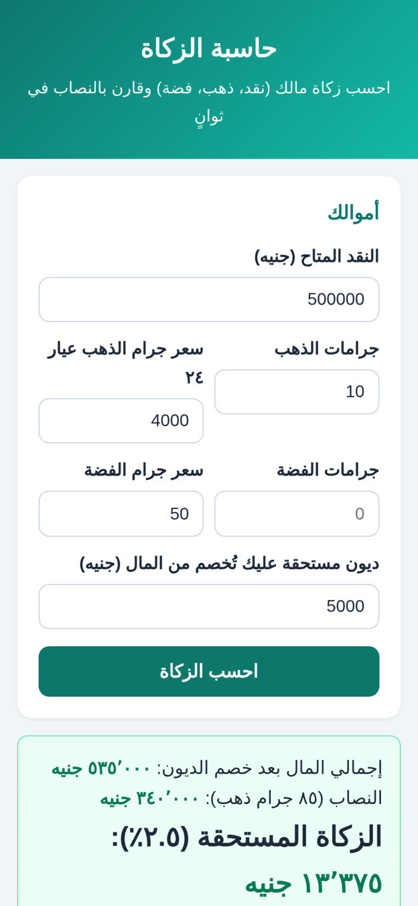

# Zakat Calculator | حاسبة الزكاة

Calculate zakat on cash, gold and silver, with an automatic nisab check. Arabic interface.

**Live app:** https://abood-ayman.github.io/zakat-calculator-ar/

This is a personal project, built with AI tools.

## Features
- Total wealth after deducting due debts
- Automatic nisab comparison (85 g of gold at a price you enter)
- Zakat due (2.5%) once the nisab is reached
- Prices are editable to match the current market

## Note
Guidance only: for a ruling on your specific case, consult a scholar.

## Privacy
Everything runs in your browser. No data is stored or sent anywhere.

## Run locally
Open `index.html` in any browser. It is a single static page with no dependencies.

## Status
Stable.

## Copyright
MIT License - Copyright (c) 2026 Abdullah Ayman.
